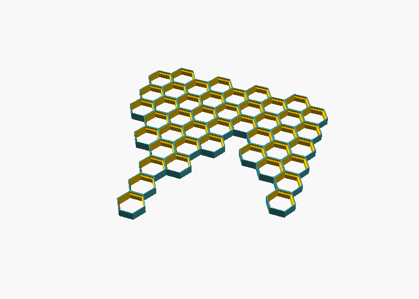
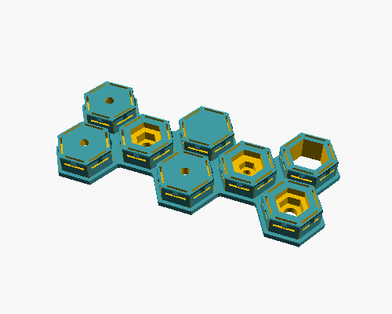
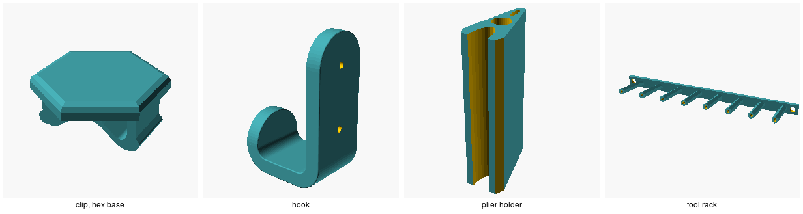

# honeycomb-wall-scad

A parametric honeycomb storage wall in OpenSCAD, with the snap-in inserts,
clips and attachments that go on it. Print the wall in panels to fit your
bed, mount it with screws through screw-type inserts, and push inserts into
any cell. The wall, the inserts and
the clips all read one set of sizes, so changing the hole, the wall or the
depth keeps every part fitting.

## The parts

| File | What it makes |
| --- | --- |
| `hsw.scad` | The shared sizes and the cell geometry. Every other part includes it. |
| `honeycomb-wall.scad` | The wall: fill a print bed, or lay it out column by column. |
| `inserts.scad`, `examples/inserts.scad` | Snap-in inserts, single or joined in groups. |
| `hsw-clips/hsw_clip.scad` | One-way clips and a connector that joins two wall panels. Needs [BOSL2](https://github.com/BelfrySCAD/BOSL2). |
| `attachments/` | A screw-on hook, a plier holder, and a tool rack of pegs or rings. |

### Shared sizes (`hsw.scad`)

| Parameter | Default | |
| --- | --- | --- |
| `hsw_hole` | 20 | Hole across flats, mm. |
| `hsw_wall` | 1.8 | Wall around each hole; neighbouring cells sit wall to wall, 23.6 mm apart. |
| `hsw_depth` | 8 | Grid depth, back to front. At least `hsw_lock_z + hsw_lip_depth` (7.1 mm). |
| `hsw_lock_z`, `hsw_lip_depth`, `hsw_lip` | 5.1, 2, 1 | The hole is `hsw_hole` wide from the back to `hsw_lock_z`, then widens by `hsw_lip` per side to the front opening, `hsw_lip_depth` deep. |
| `hsw_back_chamfer_w`, `_h` | 0.4, 0.5 | Chamfer on each hole's back edge, against elephant's foot. |

Set them with `-D` on the command line, or in the Customizer of whichever part
you're making.

## The wall

Open `honeycomb-wall.scad`. By default it fills `max_grid_width` ×
`max_grid_height`: 211 × 248 mm, about 10 × 10 cells on a Bambu Lab A1.

- `column_data_index` picks a column-by-column layout from `column_data`,
  such as the example above or the two layouts for the ends of an IKEA 365+
  drybox.
- `include_offsets` moves columns up or down by whole cells,
  `include_gaps` leaves chosen cells out, and `include_solids` closes the
  front of chosen cells.
- `edge_left`, `edge_top`, `edge_right` and `edge_bottom` cut the outer cells
  in half and close them with a flat wall, for butting panels together or
  against a frame.

Print it back face down.

## Inserts

An insert's body pushes into a cell, its lip stays on the front face, and six
snaps hold it. In `examples/inserts.scad`, set `layout` to a list of rows,
bottom row first, each a list of types:

| Type | Centre |
| --- | --- |
| 0 | no insert |
| 1 | open |
| 2 | solid |
| 3 | countersunk screw |
| 4, 5, 6 | M3, M4, M5 nut trap |
| 7, 8 | screw hole with an open back, plain or countersunk |

Rows are half a cell apart and odd rows sit half a column to the right, so a
layout interlocks like the wall's cells. Neighbouring inserts are joined by
connectors across the wall between them. `tolerance` shrinks the parts that
go into the cell, and `decoration` adds a groove pattern and chamfers to the
face. Print inserts lip face down.

## Clips and attachments

`hsw-clips/hsw_clip.scad` makes a one-way clip, with an optional hex or
rectangular base, and a connector that holds two neighbouring wall panels
together. Turn on `generate_clip` or `generate_clipconnector`, plus a base.

The attachments screw to the wall or anywhere else:

- `attachments/hook.scad`: a J-shaped hook, filleted or chamfered, with
  optional countersunk screw holes.
- `attachments/plier_holder.scad`: a rounded wedge for pliers, screwed on
  through its middle.
- `attachments/tool_holder.scad`: a flange strip with a row of angled hex
  pegs (bored through, for bits or spokes) or rings for screwdriver shanks.

## Checks

`just test` takes about 2 s on OpenSCAD 2026.10.15. It checks:

- the wall's size, its pieces and its volume, for a full bed, a custom
  layout, all four flat edges, and a 25 mm hole with a 2.5 mm wall;
- the hole's width at four heights: the back chamfer, the straight part, the
  widening and the front opening;
- an insert seated in a cell, at the default and the 25 mm sizes: the lip
  lies on the front face, the body clears the hole, and only the six snaps
  press into the wall, behind the lock;
- the clip at both hole sizes, insert layouts joined and apart, every
  attachment, and that a depth too shallow for the lock is refused.

`just images` renders the pictures in this README.

## Licence

MIT; see [LICENSE](LICENSE). `hsw-clips/` is Hugh Kern's
[3d-scad-hsw-clip](https://github.com/geru/3d-scad-hsw-clip), also MIT; see
[its licence](hsw-clips/LICENSE.txt).
